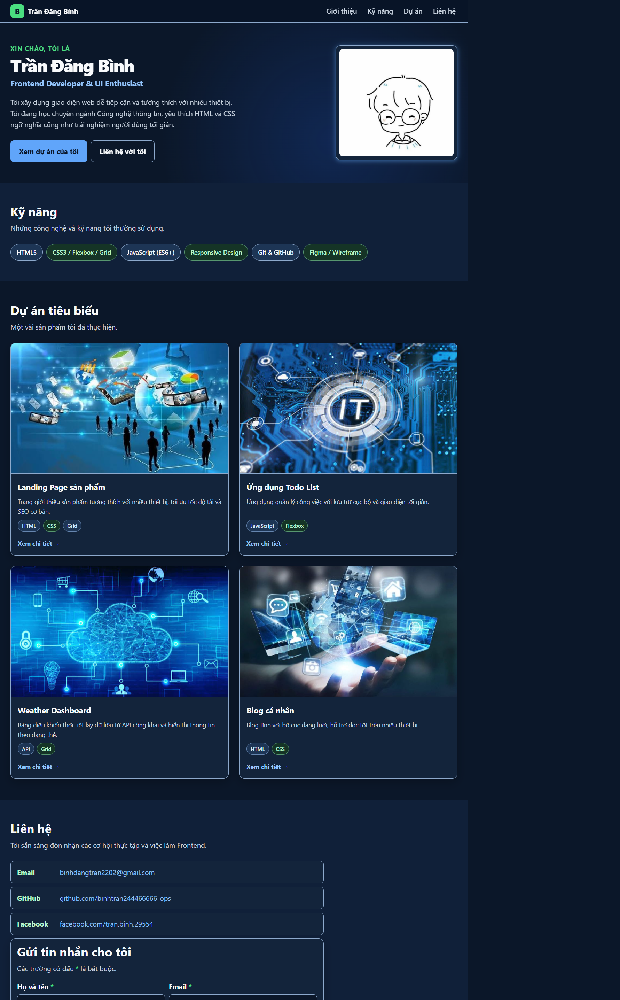
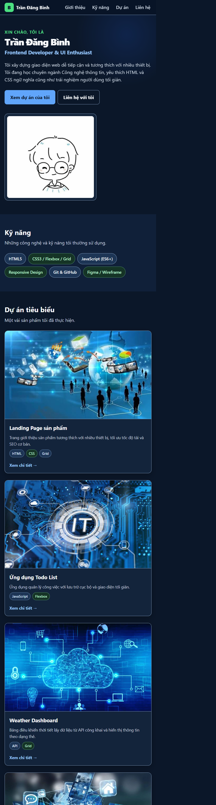
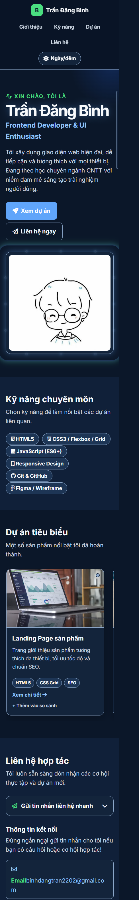

# My-CV — Portfolio cá nhân

[](https://developer.mozilla.org/docs/Web/HTML)
[](https://developer.mozilla.org/docs/Web/CSS)
[](#kiến-trúc-pure-css)
[](#responsive-và-breakpoint)
[](#responsive-và-breakpoint)
[](./docs/RELEASENOTE.md)

Portfolio cá nhân của **Trần Đăng Bình — Frontend Developer & UI Enthusiast**. Phiên bản **2.0.0** được xây dựng như một website tĩnh bằng HTML5 và CSS3, ưu tiên mobile-first; các tương tác giao diện của chính portfolio không cần JavaScript.

> **Phạm vi “Zero-JavaScript”:** website portfolio không tải hoặc chạy JavaScript. Các tên công nghệ JavaScript xuất hiện trong thẻ mô tả dự án là thông tin của những sản phẩm được giới thiệu, không phải dependency/runtime của website này.

## Nội dung

- [Tính năng nổi bật](#tính-năng-nổi-bật)
- [Công nghệ và kiến trúc](#kiến-trúc-pure-css)
- [Cấu trúc dự án](#cấu-trúc-dự-án)
- [Xem trước giao diện](#xem-trước-giao-diện)
- [Cài đặt và chạy local](#cài-đặt-và-chạy-local)
- [Triển khai](#triển-khai)
- [Tác giả và liên hệ](#tác-giả-và-liên-hệ)

## Tính năng nổi bật

- **Hồ sơ cá nhân:** phần giới thiệu, kỹ năng, bốn dự án tiêu biểu và thông tin liên hệ.
- **Chuyển sáng/tối:** checkbox điều khiển kết hợp `:has()`; các design token màu được đăng ký bằng `@property` để chuyển màu có chuyển động.
- **Điều hướng theo ngữ cảnh:** header sticky có hiệu ứng kính mờ; trạng thái liên kết theo `:target` và hiệu ứng nhấn viền khi đến section.
- **Làm nổi bật dự án theo kỹ năng:** các radio ẩn điều khiển selector `:has()` để làm nổi dự án có nhãn phù hợp; có tùy chọn “Hiện tất cả”. Thẻ dự án hiện tại chưa gắn nhãn Git & GitHub, nên chọn kỹ năng này không làm nổi thẻ nào.
- **Chi tiết dự án:** bốn hộp thoại được điều khiển bằng fragment `:target`, có liên kết đóng và backdrop.
- **Khay so sánh:** checkbox gắn với từng dự án; khay trượt lên khi có lựa chọn và chỉ hiển thị nội dung của dự án đã chọn.
- **Tin nhắn nhanh:** panel mở/đóng bằng CSS Grid; trình duyệt kiểm tra các trường `required` và `type="email"`; thanh tiến độ tăng 20% cho mỗi trường hợp lệ. Gửi biểu mẫu hiện thông báo trạng thái, chưa chuyển dữ liệu tới backend.
- **Chi tiết thị giác và tiếp cận:** avatar có viền LED, thẻ dự án xòe quạt trên thiết bị chuột, thanh tiến độ cuộn trang, trạng thái `:focus-visible` và quy tắc `prefers-reduced-motion`.

## Kiến trúc Pure CSS

| Cơ chế | Cách triển khai |
|---|---|
| Theme sáng/tối | `@property` đăng ký các biến màu; `:has(#theme-switch:checked)` đổi bộ design token. |
| Điều hướng | Header `position: sticky` và `backdrop-filter`; `:target` nhận diện section và tạo hiệu ứng đến đích. |
| Lọc dự án | Radio kỹ năng phối hợp `:has()` và nhãn công nghệ trên thẻ để làm mờ/làm nổi dự án; radio “Hiện tất cả” khôi phục danh sách. |
| Chi tiết dự án | Bốn `dialog` mở theo fragment `#project-1` đến `#project-4`; CSS hiển thị backdrop và hộp thoại đang được nhắm tới. |
| So sánh dự án | Checkbox liên kết với khay; `:has(.cmp-check:checked)` điều khiển trạng thái khay và các mục so sánh. |
| Biểu mẫu | `grid-template-rows` điều khiển panel; `:valid` cộng dồn năm trạng thái, mỗi trạng thái tương ứng 20%; `:target` hiển thị thông báo gửi. |
| Chuyển động và accessibility | `animation-timeline: scroll()` có điều kiện hỗ trợ; focus bàn phím được làm rõ và animation giảm theo `prefers-reduced-motion`. |

### Dự án được giới thiệu

| Dự án | Công nghệ/nhãn hiển thị trên thẻ |
|---|---|
| Landing Page sản phẩm | HTML5, CSS Grid, SEO |
| Ứng dụng Todo List | JavaScript, LocalStorage, Flexbox |
| Weather Dashboard | Fetch API, CSS Grid, Async/Await |
| Blog Cá Nhân | HTML5, CSS Modern, UI/UX |

## Công nghệ và yêu cầu

- HTML5 ngữ nghĩa và CSS3; không cần Node.js, npm, backend hoặc bước build.
- Trình duyệt hiện đại có hỗ trợ các tính năng CSS được sử dụng, đặc biệt `:has()` và `@property`.
- Ảnh đại diện nằm trong repository. Google Fonts, Font Awesome và ảnh minh họa dự án được lấy từ dịch vụ bên ngoài, vì vậy cần Internet để tải đầy đủ các tài nguyên đó.

## Responsive và breakpoint

Thiết kế đi từ màn hình nhỏ lên màn hình lớn:

| Mốc | Bố cục |
|---|---|
| Mobile, dưới 768 px | Nội dung một cột; danh sách dự án cuộn ngang với `scroll-snap-type: x mandatory`. |
| Tablet, từ 768 px | Hero hai cột; lưới dự án hai cột; biểu mẫu hai cột. |
| Desktop, từ 1100 px | Bốn dự án trên một hàng; danh sách liên hệ ba cột. |

## Cấu trúc dự án

```text
My-CV/
├── index.html
├── README.md
├── BAOCAO-A2.1.docx
├── assets/
│   ├── css/
│   │   └── styles.css
│   └── img/
│       └── AVATAR.png
└── docs/
    ├── AI_LOG.md
    ├── RELEASENOTE.md
    ├── test_report.md
    └── screenshots/
        ├── responsive-desktop.png
        ├── responsive-mobile.png
        └── responsive-tablet.png
```

## Xem trước giao diện

| Desktop — từ 1100 px | Tablet — 768 px | Mobile — dưới 768 px |
|---|---|---|
|  |  |  |

Các ảnh nằm tại `docs/screenshots/`; hãy chụp lại giao diện phiên bản 2.0.0 theo hướng dẫn bàn giao và ghi đè các ảnh tương ứng.

## Cài đặt và chạy local

### Lấy mã nguồn

```bash
git clone https://github.com/binhtran244466666-ops/My-CV.git
cd My-CV
```

Hoặc tải repository dạng ZIP và giải nén. Không cần cài dependency.

### Cách 1: VS Code Live Server

1. Mở thư mục dự án bằng VS Code.
2. Cài extension **Live Server** nếu máy chưa có.
3. Mở `index.html`, chọn **Open with Live Server**.
4. Trình duyệt sẽ mở địa chỉ local do Live Server cung cấp.

### Cách 2: Mở trực tiếp

Mở `index.html` bằng trình duyệt. Nếu muốn dùng một HTTP server cục bộ, chạy từ thư mục gốc:

```bash
python -m http.server 8000
```

Sau đó truy cập [http://localhost:8000](http://localhost:8000). Dừng máy chủ bằng `Ctrl+C`.

## Triển khai

Đây là website tĩnh: có thể phục vụ thư mục dự án bằng GitHub Pages, Netlify, Vercel, Nginx hoặc máy chủ HTTP tĩnh khác. Giữ nguyên các đường dẫn tương đối của `index.html`, `assets/` và các tài nguyên cần thiết. Form hiện chỉ kiểm tra dữ liệu bằng trình duyệt và hiển thị thông báo; muốn nhận/lưu tin nhắn thật cần tích hợp dịch vụ hoặc backend riêng.

## Tác giả và liên hệ

| Kênh | Thông tin |
|---|---|
| Tác giả | **Trần Đăng Bình** — Frontend Developer & UI Enthusiast |
| Email | [binhdangtran2202@gmail.com](mailto:binhdangtran2202@gmail.com) |
| GitHub | [binhtran244466666-ops](https://github.com/binhtran244466666-ops) |
| Facebook | [Trần Đăng Bình](https://www.facebook.com/tran.binh.29554) |

---

© 2026 Trần Đăng Bình. Xây dựng bằng HTML5 và CSS3.
